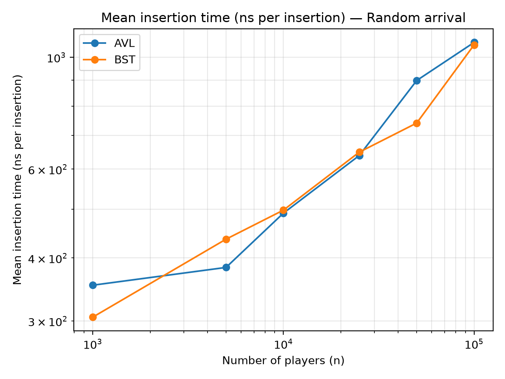
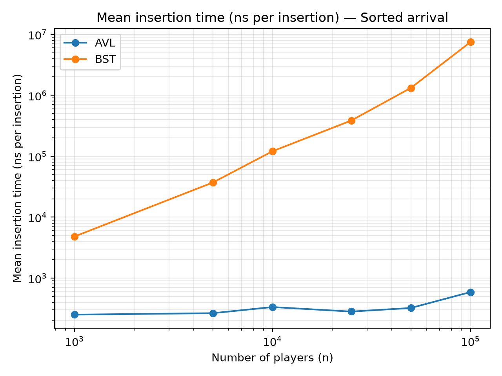
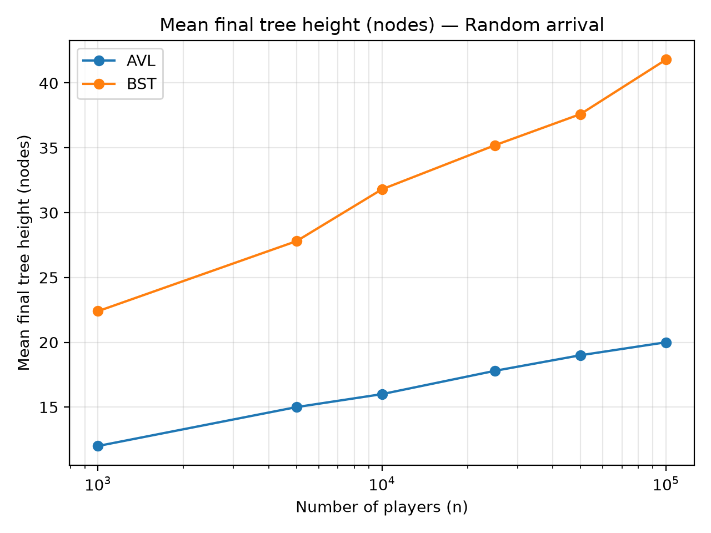
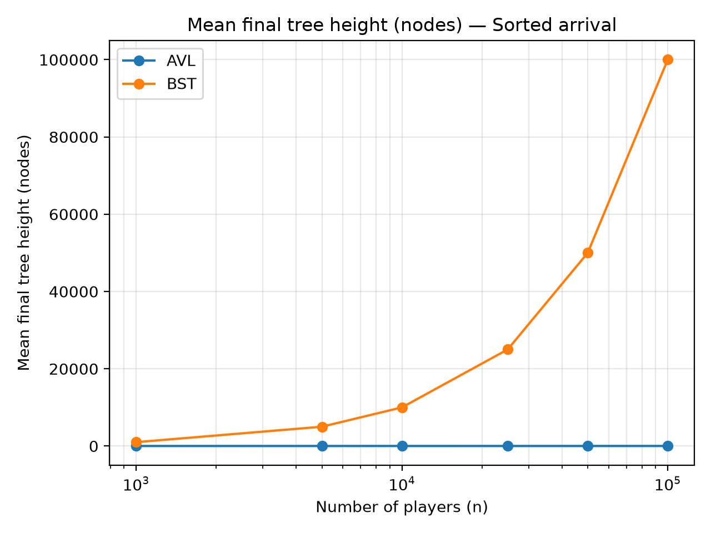
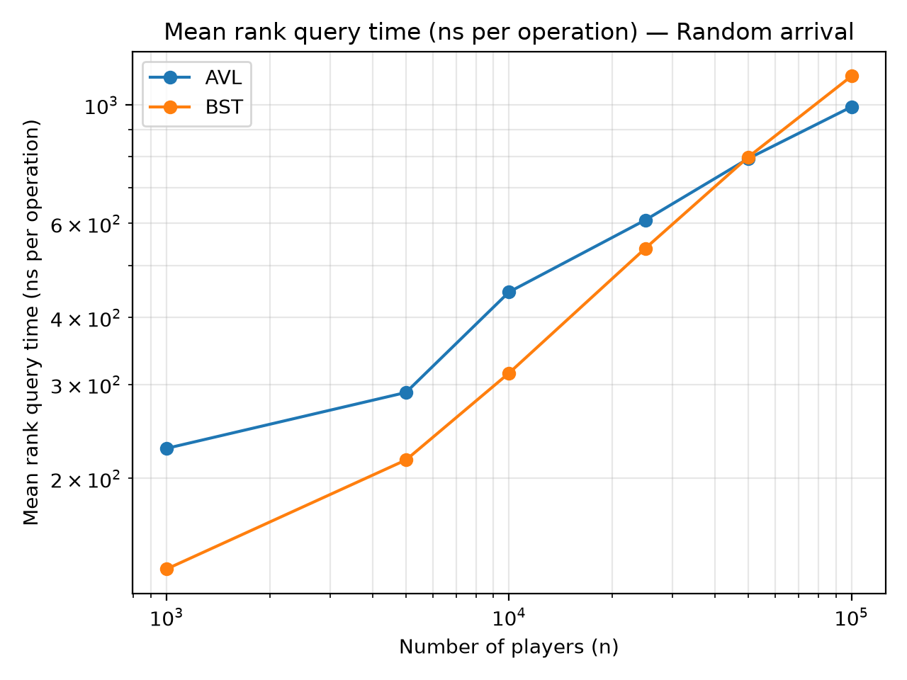
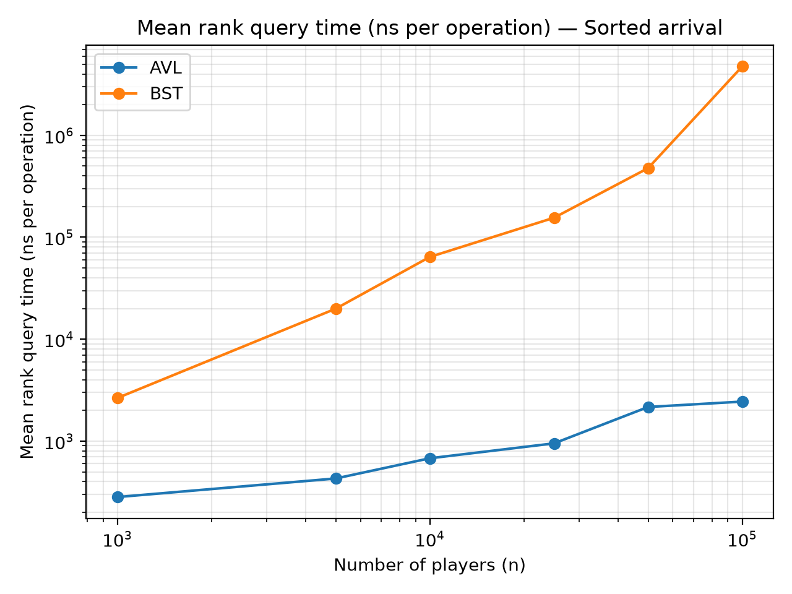
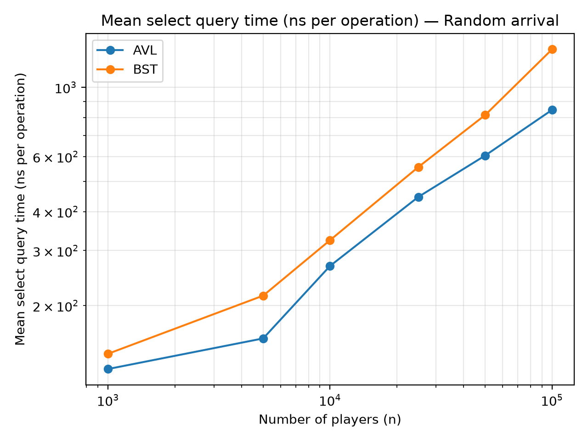
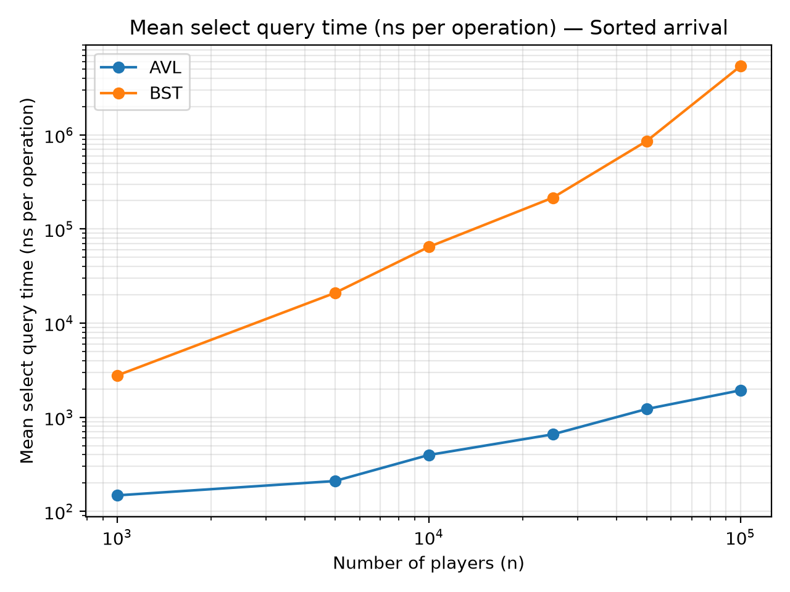
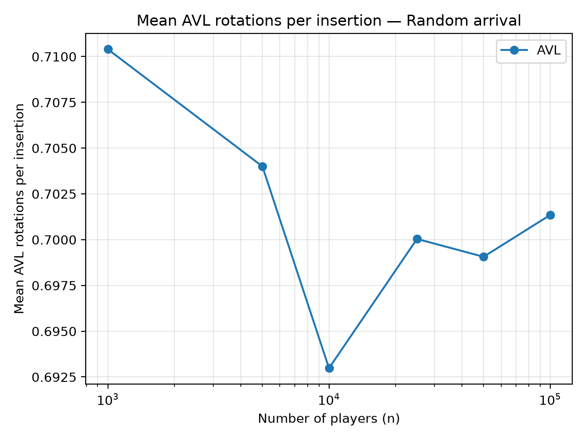
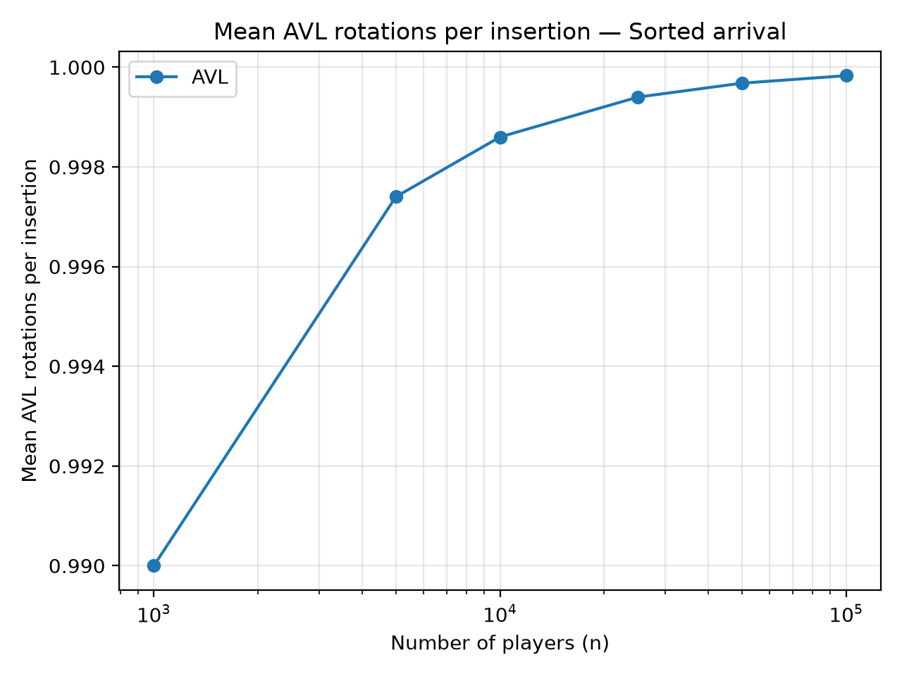

# Performance Analysis: AVL Tree vs Binary Search Tree

## 1. Objective

The objective of this experiment is to compare the performance of an AVL Tree and an ordinary Binary Search Tree (BST) under different insertion sequences.

The experiment evaluates how tree balancing affects insertion, searching-related operations, and overall tree height.

The following parameters are measured:

- Insertion time
- Tree height
- Rank query time
- Select query time
- Number of AVL rotations
- Average rotations per insertion

Both random and sorted insertion sequences are considered to understand how input order affects the performance of the two data structures.

---

## 2. Experimental Methodology

The AVL Tree and ordinary BST were evaluated using two types of insertion sequences:

1. **Random insertion:** Elements are inserted in a randomized order.
2. **Sorted insertion:** Elements are inserted in sorted order.

The benchmark was conducted for the following input sizes:

\[
n \in \{1000, 5000, 10000, 25000, 50000, 100000\}
\]

Each configuration was executed five times using different recorded seeds.

The benchmark measured:

| Metric                  | Description                                         |
| ----------------------- | --------------------------------------------------- |
| Insertion time          | Average time required to insert an element          |
| Tree height             | Height of the resulting tree                        |
| Rank time               | Average time required for rank queries              |
| Select time             | Average time required for select queries            |
| Total rotations         | Number of rotations performed by AVL                |
| Rotations per insertion | Total AVL rotations divided by number of insertions |

The measurements were recorded in CSV format and visualized using Python plotting scripts.

The reported timing comparisons use averages across five runs.

---

## 3. Theoretical Background

### 3.1 AVL Tree

An AVL Tree is a self-balancing Binary Search Tree.

For every node, the difference between the heights of its left and right subtrees must be at most one.

The balance factor is defined as:

\[
BF = Height(Left)-Height(Right)
\]

The AVL Tree maintains its balance using rotations:

- Left rotation
- Right rotation
- Left-Right rotation
- Right-Left rotation

Because the tree remains balanced, its height is logarithmic in the number of nodes.

Therefore, insertion and query operations take:

\[
O(\log n)
\]

### 3.2 Ordinary Binary Search Tree

An ordinary BST does not automatically balance itself.

Its performance depends heavily on the order in which elements are inserted.

For a balanced or reasonably shaped BST, operations can be efficient. However, when elements are inserted in sorted order, the tree can degenerate into a chain.

The complexity of an operation depends on the tree height \(h\):

\[
O(h)
\]

In the worst case:

\[
h=O(n)
\]

Therefore, an individual insertion or query can take:

\[
O(n)
\]

Constructing an ordinary BST using sorted input can consequently require:

\[
O(n^2)
\]

total time.

---

## 4. Experimental Results

### 4.1 Insertion Time Comparison

#### Random Insertion

For random insertion sequences, both AVL and ordinary BST exhibit relatively comparable insertion performance.

At \(n=100,000\), the average insertion times were approximately:

| Data Structure | Average insertion time |
| -------------- | ---------------------: |
| AVL            |               1,070 ns |
| BST            |               1,058 ns |

The AVL Tree maintains a smaller height, although its balancing operations introduce some additional computational overhead.

#### Sorted Insertion

The difference becomes significant when elements are inserted in sorted order.

At \(n=100,000\):

| Data Structure | Average insertion time |
| -------------- | ---------------------: |
| AVL            |                 589 ns |
| BST            |           7,469,057 ns |

The ordinary BST becomes highly inefficient because it degenerates into a chain.

The AVL Tree avoids this degeneration through rotations and maintains efficient insertion performance.

---

### 4.2 Tree Height Comparison

#### Random Insertion

For random insertion at \(n=100,000\):

| Data Structure | Average height |
| -------------- | -------------: |
| AVL            |             20 |
| BST            |           41.8 |

The AVL Tree maintains a smaller height because it continuously restores balance after insertion.

The ordinary BST does not guarantee balance, even with random input.

#### Sorted Insertion

For sorted insertion at \(n=100,000\):

| Data Structure | Tree height |
| -------------- | ----------: |
| AVL            |          17 |
| BST            |     100,000 |

This is one of the most important observations from the experiment.

The ordinary BST becomes a linear chain, whereas the AVL Tree maintains logarithmic height.

This demonstrates the importance of self-balancing when insertion order is unfavourable.

---

### 4.3 Rank Query Performance

#### Random Insertion

At \(n=100,000\):

| Data Structure | Average rank time |
| -------------- | ----------------: |
| AVL            |            992 ns |
| BST            |          1,132 ns |

The query performance is relatively comparable for random input, although AVL performs better in this measurement.

#### Sorted Insertion

At \(n=100,000\):

| Data Structure | Average rank time |
| -------------- | ----------------: |
| AVL            |          2,442 ns |
| BST            |      4,738,384 ns |

The unbalanced BST exhibits significantly slower rank queries because its height has increased to \(O(n)\).

The AVL Tree maintains efficient rank operations through its balanced structure.

---

### 4.4 Select Query Performance

#### Random Insertion

At \(n=100,000\):

| Data Structure | Average select time |
| -------------- | ------------------: |
| AVL            |              846 ns |
| BST            |            1,322 ns |

Both structures perform reasonably well for random input, but AVL provides better query performance in this measurement.

#### Sorted Insertion

At \(n=100,000\):

| Data Structure | Average select time |
| -------------- | ------------------: |
| AVL            |            1,932 ns |
| BST            |        5,364,505 ns |

The select operation becomes considerably slower in the unbalanced BST because it may need to traverse a large portion of the chain.

The AVL Tree maintains a much smaller height, allowing efficient selection.

---

### 4.5 AVL Rotation Analysis

Rotations are necessary for maintaining the balance of an AVL Tree.

The experiment tracks the total number of rotations and calculates the average rotations per insertion.

#### Random Insertion

The average rotations per insertion were approximately:

| Input size | Rotations per insertion |
| ---------: | ----------------------: |
|      1,000 |                    0.71 |
|     10,000 |                    0.69 |
|    100,000 |                    0.70 |

The rotation rate remains relatively stable as the input size increases.

#### Sorted Insertion

The average rotations per insertion were approximately:

| Input size | Rotations per insertion |
| ---------: | ----------------------: |
|      1,000 |                    0.99 |
|     10,000 |                    1.00 |
|    100,000 |                    1.00 |

Sorted insertion requires more frequent rebalancing in this experiment.

However, the average number of rotations per insertion remains approximately constant, demonstrating that AVL balancing does not require an increasing number of rotations per inserted element as the tree grows.

---

## 5. Overall Comparison

The experimental observations can be summarized as follows:

| Parameter                  | AVL Tree               | Ordinary BST                  |
| -------------------------- | ---------------------- | ----------------------------- |
| Self-balancing             | Yes                    | No                            |
| Height                     | \(O(\log n)\)          | \(O(h)\), worst case \(O(n)\) |
| Insertion                  | \(O(\log n)\)          | \(O(h)\)                      |
| Rank query                 | \(O(\log n)\)\*        | \(O(h)\)\*                    |
| Select query               | \(O(\log n)\)\*        | \(O(h)\)\*                    |
| Rotations                  | Required for balancing | Not required                  |
| Sorted insertion           | Maintains balance      | Can degenerate into a chain   |
| Performance predictability | High                   | Depends on insertion order    |

\*Assuming the implementation maintains subtree-size information for rank and select operations.

---

## 6. Performance Analysis and Discussion

The experimental results demonstrate the importance of self-balancing in maintaining efficient tree operations.

For random insertion sequences, both AVL and ordinary BST exhibit relatively good performance. Their average insertion times are comparable, although the AVL Tree maintains a smaller height due to its balancing mechanism. At \(n=100,000\), the average heights were 20 for AVL and approximately 42 for BST.

However, the difference becomes significant for sorted insertion sequences. The ordinary BST degenerates into a chain, with its height increasing linearly with the number of elements. At \(n=100,000\), its height reached 100,000. In contrast, the AVL Tree maintained a height of only 17.

This difference directly affects insertion and query performance. For sorted input at \(n=100,000\), the average insertion time per operation was approximately 589 ns for AVL and 7,469,057 ns for BST. Similarly, rank and select operations became considerably slower in the unbalanced BST.

The rotation measurements also demonstrate the cost of maintaining AVL balance. The average number of rotations per insertion remained approximately 0.70 for random input and 1.00 for sorted input in our experiments. These rotations help maintain logarithmic tree height.

The experimental observations are consistent with the theoretical complexity of the two structures. AVL operations maintain \(O(\log n)\) height, while ordinary BST operations depend on the actual tree height \(h\). In the worst case, sorted insertion produces \(h=O(n)\), resulting in \(O(n)\) individual operations and \(O(n^2)\) total construction time.

---

## 7. Conclusion

Although AVL requires additional balancing operations, it provides much more reliable performance, particularly for sorted or unfavourable insertion sequences.

An ordinary BST can perform competitively for random input, but its performance is highly dependent on insertion order.

The experiment demonstrates that maintaining tree balance is important for ensuring efficient insertion and query operations as the dataset grows.

Therefore, AVL is more suitable when predictable operation times and consistent performance are important.

---

## 8. Notes and Limitations

1. All measured execution times are dependent on the hardware, compiler, optimization settings, and system environment.
2. The reported values represent averages across five experimental runs.
3. The results are empirical observations and do not constitute mathematical proof of theoretical complexity.
4. The benchmark uses specific random seeds and insertion sequences; different sequences may produce different BST heights and timings.
5. AVL rotations introduce balancing overhead, but this overhead helps prevent worst-case degeneration.
6. The benchmark results should be interpreted together with the raw CSV measurements and generated plots.

## 9. Reproducibility

The benchmark implementation and plotting scripts are available in the `bench/` directory.

- `benchmark.cpp` — benchmark implementation.
- `plot_results.py` — graph generation script.
- `README.md` — instructions for running the benchmark.
- `results/benchmark_raw.csv` — raw experimental measurements.
- `results/benchmark_raw_figures/` — generated performance graphs.

The raw measurements can be used to independently verify the reported averages and reproduce the visualizations.
